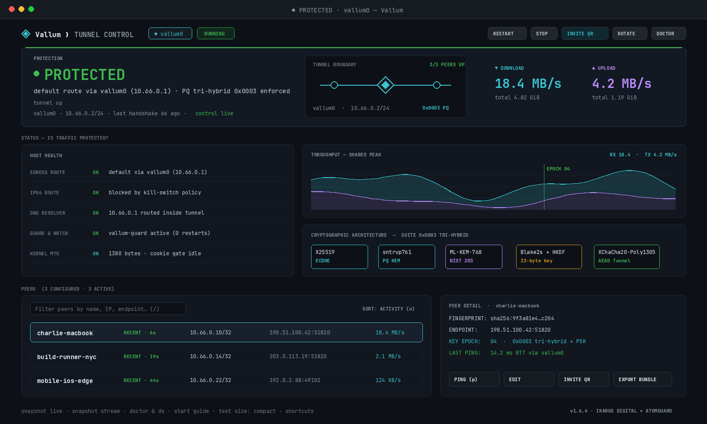
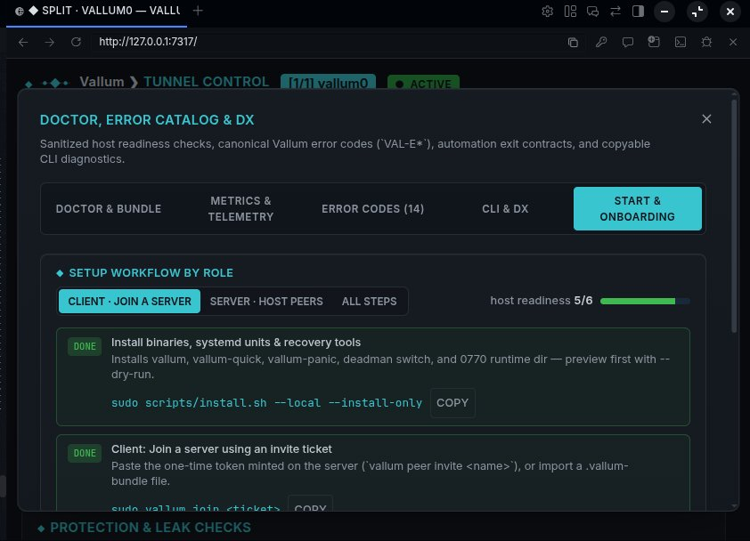
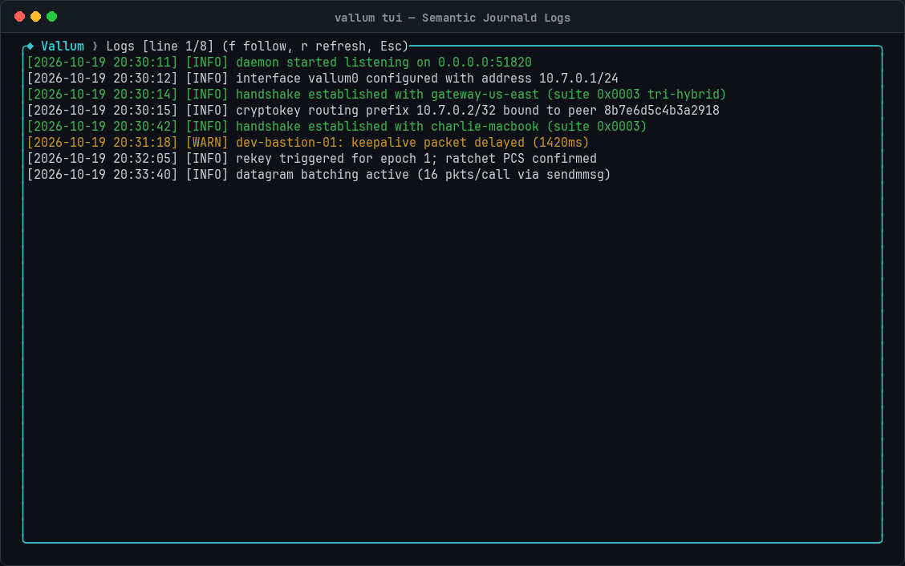

# Vallum

<p align="center">
  
</p>

<p align="center">
  <a href="https://github.com/KidIkaros/vallum/releases"></a>
  <a href="LICENSE"></a>
  <a href="Cargo.toml"></a>
  <a href="https://github.com/KidIkaros/vallum"></a>
  <a href="docs/gui.md"></a>
</p>

<p align="center">
  <b>A deployable, hybrid post-quantum layer-3 tunnel for Linux</b>
  <br>
  <em>Production client and gateway VPN with real-time operations telemetry, live cyberpunk cockpits (TUI & Desktop GUI), and zero private-key exposure.</em>
  <br>
  <sub>Developed in joint engineering partnership between <b>Ikaros Digital</b> and <b>Atomguard</b>.</sub>
</p>

---

## Highlights

- 🛡️ **Tri-Hybrid Post-Quantum Cryptography (`Suite 0x0003`)**  
  Combines classical **X25519** with **sntrup761** and **ML-KEM-768** via HKDF-SHA3-256. Compromising session confidentiality requires breaking all three algorithms simultaneously.
- ⚡ **Zero-Custody Enrolment & Key Rotation**  
  Clients generate their own private keys locally. Servers exchange short-lived, pinned join tickets or animated `VALLUM1` QR codes without private keys ever leaving the client device. Zero-downtime key rotation (`peer rotate` ➔ `peer finalize`) eliminates rekey outages.
- 🖥️ **Dual Operations Cockpits (TUI + Cyberpunk GUI)**  
  Real-time telemetry, spline throughput charts, animated packet-pipeline tracking, live topology flow lanes, scannable QR generation, inline TOML configuration editor with diffs, and structured `VAL-E*` diagnostics.
- 🔒 **Fail-Closed Guard & CVE-2019-14899 Hardening**  
  Automatic detection and mitigation of IPv6, routing, and DNS egress leaks (`vallum doctor`), raw input-chain anti-spoofing + `src_valid_mark=1` / `arp_ignore=2`, systemd deadman switch, and full-tunnel rollback trials.
- 🌐 **Adaptive Carriers (`udp`, `lwo`, `auto`, `tcp`) & Proxy Upgrade**  
  Zero-overhead SplitMix64 UDP header masking with handshake length jitter (`carrier = "lwo"`), happy-eyeballs 500ms LWO-to-TCP racing (`carrier = "auto"`), framed TCP fallback (`carrier = "tcp"`) with HTTP/1.1 `101 Switching Protocols` reverse-proxy upgrade (`/_vallum` for Caddy/Nginx TLS `:443`), and closed-loop adaptive MTU tuning (`vallum doctor --tune-mtu`). `auto` validates handshake TLV/index/`mac1` before locking a carrier and replays up to 100 initial packets onto TCP.
- 🧭 **Loopback DNS Proxy (`vallum-quick dns-proxy`)**  
  Bounded-concurrency forwarder with RFC1918 LAN vs in-tunnel resolver split, `AAAA` suppression on IPv4-only tunnels, and `198.51.100.1` captive-portal spoofing while blocked.
- 🔌 **Clean Decoupled Architecture**  
  Built on a clean `CryptoSuite` boundary trait (`vallum-crypto`) with zero hardcoded SDK locks. Protocol framing, key schedule, and sans-I/O datapath remain isolated from the underlying crypto engine.

---

## Operations Cockpits

Vallum ships two synchronized, zero-compromise operations cockpits with feature parity:

### 1. Cyberpunk GUI Cockpit (`vallum-gui`)
Runs either as a native desktop application (via Tauri) or as a secure, authenticated local web console (`vallum-gui --serve 7317`).

- **Real-Time Animated Telemetry:** Spline RX/TX throughput charts with dynamic leading-edge beacons, 4-stage connection progress ladder (`Leak Guard` ➔ `Carrier Bind` ➔ `PQ Handshake` ➔ `Tunnel Verified`), live payload-vs-cover packet stream, streaming egress lanes (`FlowLane`), and live packet pipeline stage monitors.
- **User Identity & Key Management:** Local operator profiles, scannable public key QR codes (`qrFrame`), offline ML-KEM keypair generation studio, and config backup downloads.
- **Everyday QoL:** Next-available subnet IP suggestions (`10.7.0.x/32`), carrier transport chips (`udp`, `lwo`, `auto`, `tcp`), one-click DNS presets (Cloudflare `1.1.1.1`, Quad9 `9.9.9.9`, Mullvad), live **Probe Live Path** Adaptive MTU optimizer (`1280` / `1340` / `1380` / `1420`), and auto-clipboard invite tickets.
- **Doctor & Diagnostic Modal (`d`):** Integrated `VAL-E*` error codes, host preflight verification, and systemd service lifecycle controls.

<p align="center">
  
</p>
<p align="center"><sub>Doctor modal with the role-based <b>Start &amp; Onboarding</b> workflow and live host-readiness score.</sub></p>

*Learn more in the [`vallum-gui` Documentation](docs/gui.md).*

### 2. Terminal Operations Cockpit (`vallum tui`)
High-density, low-overhead TUI designed for remote servers, headless gateways, and terminal power users.

<p align="center">
  
</p>
<p align="center">
  <a href="assets/vallum-demo.mp4"><b>▶ Download HD Video Capture (.mp4)</b></a> · <a href="assets/vallum-cockpit.svg"><b>View Vector SVG</b></a>
</p>

| Peer Selection & Detail | Command Palette (`:`) |
|:---:|:---:|
|  |  |
| **Peer Ping Connectivity Probe (`p`)** | **One-Time Enrolment QR (`v`)** |
|  |  |
| **Semantic Journald Logs (`l`)** | **Brand & Visual Language** |
|  |  |

*Learn more in the [`vallum tui` Documentation](docs/tui.md).*

---

## Why Vallum?

PQ-WireGuard (Hülsing–Ning–Weber–Schwabe–Zimmermann, 2023) proved a KEM-only handshake can replace WireGuard's non-interactive DH. Vallum takes that foundation into production reality:

| Vector | WireGuard / PQ-WireGuard | Vallum |
|---|---|---|
| **Hybrid KEM** | Classical only or single PQ leg | **Tri-hybrid**: `X25519 + sntrup761 + ML-KEM-768` + HKDF-SHA3-256 |
| **Hybrid Auth** | Static keys only, no expiry | Transcript signatures, CA-issued identity docs, timed validity ([ADR-0014](docs/adr/0014-wireguard-gaps.md)) |
| **Key Independence** | Key reuse between KEM and signing | **Rejected by design**: master seed derives strictly separate KEM and signing keys |
| **Epoch & PCS** | No epoch or erasure discipline | Re-key initiates fresh hybrid handshake; superseded epochs erased after `REJECT_AFTER_TIME` |
| **Traffic Analysis** | None | Maybenot-style packet shaping and padding inside AEAD |
| **Client Key Custody** | Manual copy or server-minted keys | Client retains private keys; uses `--join` (enrolment v2) or `--remote` (SSH) ([ADR-0015](docs/adr/0015-enrolment-v2.md)) |
| **Key Rotation** | Outage required | **Zero-downtime**: dual acceptance during rotation until `peer finalize` |
| **Observability & Ops** | Basic counters, manual teardown | Native Prometheus metrics, MTU probes, clean teardown, `systemd` guard, interactive UI |

---

## Architectural Boundary

```
   protocol (handshake · key schedule · framing · data plane)
        │  bytes only — no provider type crosses this line
        ▼
   vallum-crypto        -- CryptoSuite trait + protocol combiners (zero deps)
        ▲
   ┌────┴─────────────────────────┐
   │                              │
vallum-crypto-sdk            (future adapter)
(origin-crypto-sdk)          same trait, new suite id
```

- **`vallum-crypto`**: Pure Rust `CryptoSuite` trait, protocol combiner, and transcript hash. Zero external dependencies.
- **`vallum-crypto-sdk`**: The sole crate binding to `origin-crypto-sdk`.
- **`vallum-crypto-contract`**: Suite-agnostic verification suite testing KEM round-trips, tamper resistance, combiners, and AEAD encryption.

---

## Handshake & Suite Registry

Three messages, three hybrid-KEM operations, one round trip:

```
Initiator                                              Responder
InitHello    ── STATIC_CT (A) · EPHEMERAL_PK · TIMESTAMP ──▶   [static key]
             ◀── EPHEMERAL_CT (B) · STATIC_CT (C) · conf_r ──   RespHello
InitConf     ── conf_i ────────────────────────────────────▶   [verify]
```

Both static operations are **MEX-bound** (`KDF1(σ, r)`) with mutual explicit key confirmation ([proof details](docs/proof/eck-pfs-psk.md)).

| Suite ID | Cryptographic Legs | Status | Profile |
|:---:|---|:---:|---|
| `0x0001` | X25519 + sntrup761 | Supported | Non-NIST fallback |
| `0x0002` | X25519 + ML-KEM-768 | Supported | Fast profile |
| **`0x0003`** | **X25519 + sntrup761 + ML-KEM-768** | **Default** | **Tri-Hybrid (Standard)** |

---

## Deployment & Quickstart

See the comprehensive **[Quickstart Guide](docs/quickstart.md)** for prerequisites and topology scenarios.

### Installation

```sh
# Install from release (or --local from checkout)
sudo ./scripts/install.sh --from-release
```

### 1. Server Setup (Gateway)
Initializes keys, config, IP forwarding, firewall NAT rules, and systemd units:
```sh
sudo vallum setup --server
```

### 2. Client Enrolment

#### Method A: Join via One-Time Invite Ticket (Recommended)
```sh
# On the server (or press 'v' in TUI / click '+ Invite Device' in GUI):
sudo vallum peer invite laptop

# On the client device:
sudo vallum join vallum1-join:<host>:<port>/<name>/<id>/<token>/<fp>
```

#### Method B: Local Key Generation (Zero-Custody File Exchange)
```sh
# On the client:
sudo vallum keygen --output laptop.key
sudo vallum pubkey --private-key laptop.key     # Share this line with the server

# On the server:
sudo vallum peer add laptop --public-key-file laptop.pub --client-config-out laptop.toml

# On the client:
sudo vallum setup --client-config laptop.toml
```

#### Method C: Automated Setup via SSH
```sh
sudo vallum setup --remote you@vpn.example.com
```

### 3. Launching the Cockpit
```sh
# Launch the desktop UI (or start the localhost web console):
vallum-gui
# Or headless web server:
vallum-gui --serve 7317

# Or launch the terminal cockpit:
vallum tui
```

---

## Operational Commands

```sh
# Diagnostics, closed-loop MTU sweep & health probe
vallum doctor --config /etc/vallum/vallum0.toml --tune-mtu

# Explicit target MTU sweep
vallum doctor --config /etc/vallum/vallum0.toml --probe-mtu 1.1.1.1

# Prometheus telemetry export
vallum metrics --config /etc/vallum/vallum0.toml

# Zero-downtime key rotation
sudo vallum peer rotate laptop --public-key <new-line>
sudo vallum peer finalize laptop

# Teardown
sudo vallum server teardown --dry-run
sudo vallum client teardown --name laptop
```

---

## Repository Structure

```
crates/
  vallum-crypto/            CryptoSuite trait + combiners (zero deps)
  vallum-crypto-sdk/        origin-crypto-sdk adapter + DudeCT harnesses
  vallum-crypto-contract/   Suite-agnostic contract tests
  vallum-core/              Handshake, key schedule, wire framing, AEAD, shaping
  vallum-tunnel/            Sans-IO transport: routing, state, cookies, reassembly
  vallum-config/            TOML configuration parser & validation
  vallum-quick/             Routing, policy routing (fwmark), DNS, firewall hooks
  vallum/                   Daemon, CLI, enrolment responder, UAPI socket, TUI
  vallum-gui/               Tauri desktop app & localhost web console (React + Vite)
docs/
  adr/                      Architectural Decision Records (0001..0026)
  deployment/               Server, client, site-to-site, automation, troubleshooting
  proof/                    Cryptographic proofs, DoS models, fuzzing reports
scripts/
  verify.sh                 fmt + clippy + workspace tests + netns E2E gate
  verify-remote.sh          Two-host acceptance harness across all transports
  gui-smoke.sh              End-to-end GUI backend and RPC smoke test suite
```

---

## Security & Cryptographic Posture

- **Tri-Hybrid KEM**: Combines classical `X25519` with post-quantum `sntrup761` and `ML-KEM-768`. Breaking confidentiality requires compromising all three algorithms.
- **Reachability & Transport**: `udp` by default alongside zero-overhead LWO obfuscation + handshake length jitter (`carrier = "lwo"`), happy-eyeballs 500ms LWO-to-TCP racing (`carrier = "auto"`), and framed TCP fallback (`carrier = "tcp"`) supporting HTTP/1.1 `101 Switching Protocols` reverse-proxy upgrades (`/_vallum` behind Caddy/Nginx TLS `:443`), paired with AEAD padding and Maybenot-style traffic shaping ([ADR-0026](docs/adr/0026-censorship-resistance.md), [ADR-0042](docs/adr/0042-layer4-tls-and-adaptive-mtu.md)).
- **Audit Status**: Post-quantum algorithms utilize `origin-crypto-sdk` (`EXPERIMENTAL`). Formal audits are ongoing; deployers should evaluate threat models accordingly.

### Reverse-Proxy TLS `:443` Example (Caddy)
```caddyfile
vpn.example.com {
    reverse_proxy /_vallum 127.0.0.1:51820
}
```

---

## Development & Verification

```sh
# Run full verification suite (fmt, clippy, unit tests, netns E2E)
E2E=1 ./scripts/verify.sh

# Run GUI smoke tests
./scripts/gui-smoke.sh

# Run benchmarks
vallum bench
```

---

## Partnership & License

Vallum is developed under the [Apache-2.0 License](LICENSE) through a joint engineering partnership between **Ikaros Digital** and **Atomguard**. Release procedures are documented in [`docs/releasing.md`](docs/releasing.md).

