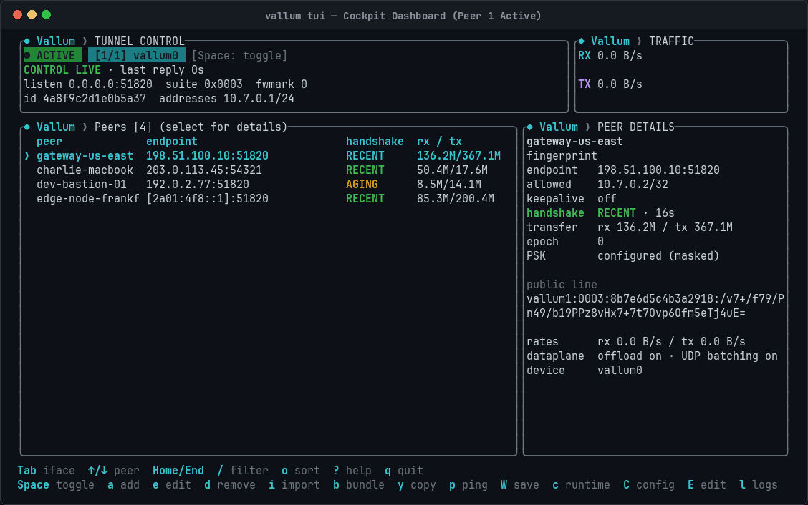
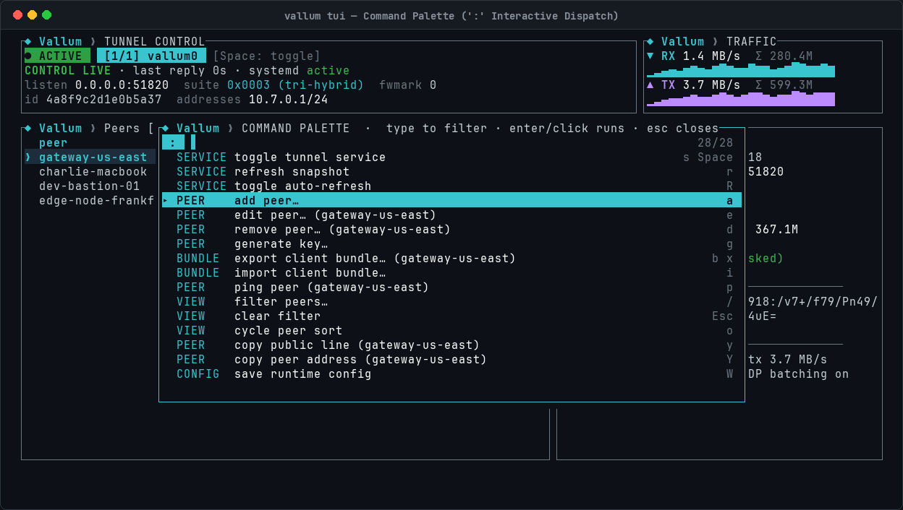
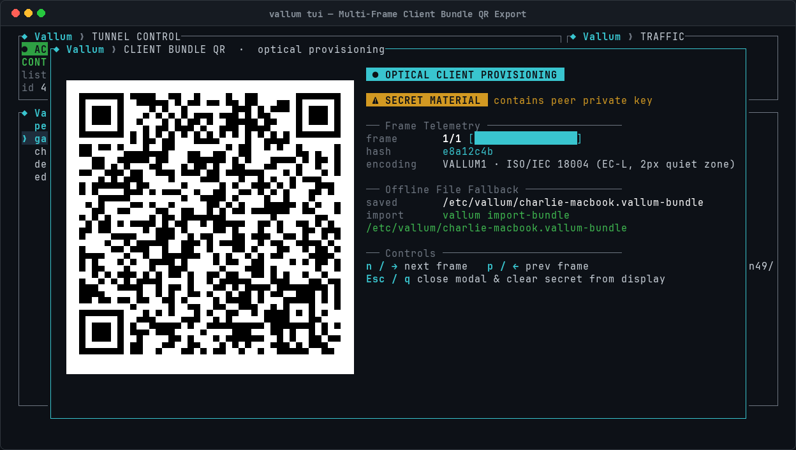
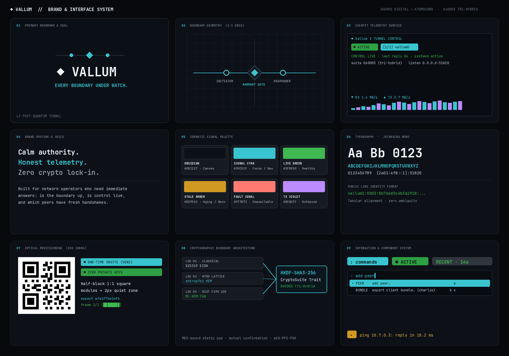

# Vallum

[](LICENSE)
[](Cargo.toml)

A hybrid **post-quantum layer-3 tunnel** — a deployable Linux server and client VPN, not a reference crate. Developed in joint engineering partnership between **Ikaros Digital** and **Atomguard**.

<p align="center">
  
</p>
<p align="center">
  <em>Live operations cockpit: tri-hybrid PQ tunnel state, shared-scale sparklines, one-time invite QR provisioning, and live dataplane counters.</em>
  <br>
  <a href="assets/vallum-demo.mp4"><b>▶ Download HD Video Capture (.mp4)</b></a> · <a href="assets/vallum-cockpit.svg"><b>View Vector SVG</b></a>
</p>

Vallum is built *on top of* `origin-crypto-sdk` but never *inside* it: every cryptographic operation goes through a Vallum-owned boundary trait (`vallum-crypto`), so the underlying cryptographic provider can be swapped without touching the protocol, framing, or daemon.

## Why it exists

PQ-WireGuard (Hülsing–Ning–Weber–Schwabe–Zimmermann, 2023) proved a KEM-only handshake can replace WireGuard's non-interactive DH. Vallum takes that design as the floor and closes what it leaves open:

| Vector | Gap in PQ-WireGuard / WireGuard | Vallum |
|---|---|---|
| Hybrid KEM | one classical + one PQ leg | tri-hybrid `X25519 + sntrup761 + ML-KEM-768`, combined with HKDF-SHA3-256 |
| Hybrid signature auth | static KEM keys only, no expiry | Ed25519 + Falcon-1024 over the transcript, CA-issued identity documents with a signed validity window ([ADR-0014](docs/adr/0014-wireguard-gaps.md)) |
| Key reuse | — | **rejected on purpose**: one master seed derives an independent KEM key and signing key |
| Epoch & PCS | no epoch or erasure discipline | rekey is a fresh hybrid handshake (root independence), 2⁴⁸/2⁴⁹ caps, superseded epoch erased after `REJECT_AFTER_TIME` |
| Traffic analysis | none | Maybenot-style shaping, off by default, padding inside the AEAD |
| Client key custody | manual copy or server-minted config | `--remote` (SSH) and `--join` (enrolment v2 token + ephemeral PQ KEM) keep private keys on the client ([ADR-0015](docs/adr/0015-enrolment-v2.md)) |
| Key rotation | manual, with an outage | `peer rotate` accepts both keys until `peer finalize` retires the old identity |
| Operations | no metrics endpoint, no teardown | `vallum metrics` (Prometheus), `doctor --probe-mtu`, `server teardown`, `resolvectl` DNS, policy-routed full tunnel (`fwmark`) |

## The boundary

```
   protocol (handshake · key schedule · framing · data plane)
        │  bytes only — no provider type crosses this line
        ▼
   vallum-crypto        -- CryptoSuite trait + protocol combiners (no deps)
        ▲
   ┌────┴─────────────────────────┐
   │                              │
vallum-crypto-sdk            (future adapter)
(origin-crypto-sdk)          same trait, new suite id
```

- **`vallum-crypto`** — the `CryptoSuite` trait, protocol combiner, and transcript hash. Zero dependencies.
- **`vallum-crypto-sdk`** — the sole crate that names `origin-crypto-sdk` types.
- **`vallum-crypto-contract`** — suite-agnostic test harness verifying KEM round-trip/tamper rejection, combiner, transcript hash, committing AEAD, and hybrid signatures.

## Handshake & Suite Registry

Three messages, three hybrid-KEM operations, one round trip:

```
Initiator                                              Responder
InitHello    ── STATIC_CT (A) · EPHEMERAL_PK · TIMESTAMP ──▶   [static key]
             ◀── EPHEMERAL_CT (B) · STATIC_CT (C) · conf_r ──   RespHello
InitConf     ── conf_i ────────────────────────────────────▶   [verify]
```

Both static operations are **MEX-bound** (`KDF1(σ, r)`) and key confirmation is mutual and explicit (`docs/proof/eck-pfs-psk.md`).

| id | legs | status |
|----|------|--------|
| `0x0001` | X25519 + sntrup761 | supported (non-NIST fallback) |
| `0x0002` | X25519 + ML-KEM-768 | supported (`fast` profile) |
| **`0x0003`** | **X25519 + sntrup761 + ML-KEM-768** | **default** |

## Deploy

New here? **[Quickstart](docs/quickstart.md)** has the prerequisites and all
three topologies — client, server, site-to-site — on one page.

Install from the latest release (or `--local` from a checkout), then run `vallum setup`:

```sh
sudo ./scripts/install.sh --from-release

# 1. Server — key, config, IP forwarding, firewall, NAT, systemd units
sudo vallum setup --server

# 2a. Client — the file path. The key is made on the device; only the public
#     line crosses. The server writes a config that NAMES the key file.
sudo vallum keygen --output laptop.key          # on the device
sudo vallum pubkey --private-key laptop.key     # send that line to the server
sudo vallum peer add laptop --public-key-file laptop.pub \
    --client-config-out laptop.toml             # on the server; copy the file back
sudo vallum setup --client-config laptop.toml   # on the device: installs and proves it

# 2b. Client with SSH access — same custody, the copy done over SSH
sudo vallum setup --remote you@vpn.example.com

# 2c. Client without SSH — one invite ticket, one command, fingerprint pinned
sudo vallum peer invite laptop                  # on the server (or press `v` in `vallum tui`)
sudo vallum join vallum1-join:<host>:<port>/<name>/<id>/<token>/<fp>

# 2d. Offline fallback — server-minted bundle. It carries the client private
#     key, so it is refused unless you say you accept that.
sudo vallum peer add laptop --ship-key --bundle-out laptop.vallum-bundle --forget-key
sudo vallum setup --client laptop.vallum-bundle --allow-shipped-key
```

Operational lifecycle commands:

```sh
vallum doctor --config /etc/vallum/vallum0.toml --probe-mtu 1.1.1.1
vallum metrics --config /etc/vallum/vallum0.toml
sudo vallum peer invites                        # list live unspent invites & TTLs
sudo vallum peer rotate laptop --public-key <new-line>
sudo vallum peer finalize laptop
sudo vallum server teardown --dry-run           # cleanly reverse server init
sudo vallum client teardown --name laptop       # cleanly remove a client tunnel
```

Guides: [quickstart](docs/quickstart.md) ·
[server](docs/deployment/server.md) ·
[client](docs/deployment/client.md) ·
[site-to-site](docs/deployment/site-to-site.md) ·
[automation](docs/deployment/automation.md) ·
[upgrades](docs/deployment/upgrades.md) ·
[monitoring](docs/deployment/monitoring.md) ·
[backup](docs/deployment/backup.md) ·
[troubleshooting](docs/deployment/troubleshooting.md) ·
[security model](docs/security-model.md) ·
[roadmap](docs/roadmap.md).

## TUI (`vallum tui`)

`vallum tui` is the terminal operations cockpit: live interface and dataplane counters (`datagrams`, `packets`, `handshakes`, `fragments`), shared-scale RX/TX sparklines, one-time token invite QR generation (`v`), zero-downtime key rotation (`K` / `f`), peer ping probes (`p`), TOML diff audit (`E`), and journald log streaming (`l`).

<p align="center">
  
</p>

| Live Cockpit & Peer Telemetry | Command Palette (`:` — Interactive Dispatch) |
|:---:|:---:|
|  |  |
| **Peer Ping Connectivity Probe (`p`)** | **One-Time Enrolment Invite QR (`v` — Zero Private Keys)** |
|  |  |
| **Semantic Journald Logs (`l`)** | **First-Run Onboarding Enclave** |
|  |  |

<p align="center">
  
</p>

See [`docs/tui.md`](docs/tui.md) for the full key map and configuration overrides.

## Layout

```
crates/
  vallum-crypto/                  CryptoSuite trait + combiners (zero deps)
  vallum-crypto-sdk/              origin-crypto-sdk adapter + DudeCT harnesses
  vallum-crypto-contract/         suite-agnostic contract tests
  vallum-core/                    handshake · key schedule · TLV wire · AEAD · shaping · segmentation
  vallum-tunnel/                  sans-IO transport: peers, routing, cookies, reassembly
  vallum-config/                  TOML configuration parser & validation
  vallum-quick/                   routes, policy routing (fwmark), DNS, firewall hooks
  vallum/                         daemon, CLI, enrolment v2 responder, UAPI control socket, TUI
docs/
  adr/                            0001..0016 architectural decision records
  deployment/                     server, client, site-to-site, automation, troubleshooting
  proof/                          cryptographic, DoS, fuzzing, and operational proof artefacts
scripts/
  verify.sh                       fmt + clippy + workspace tests + netns E2E gate (E2E=1)
  verify-remote.sh                two-host acceptance harness (bundle, SSH, token v2)
```

## Security & Cryptographic Posture

- **Tri-hybrid KEM:** Combines classical `X25519` with post-quantum `sntrup761` and `ML-KEM-768`. Breaking session confidentiality requires compromising all three algorithms simultaneously.
- **Dependency Status:** Post-quantum algorithms are implemented via `origin-crypto-sdk` (`EXPERIMENTAL — NOT FOR PRODUCTION USE`). The implementations have not undergone external third-party audit; deployments should weigh risk accordingly.
- **Reachability:** UDP by default, with an opt-in TCP carrier (`carrier = "tcp"`, both ends) for paths that drop UDP: the same packets, framed, one connection per peer, about 1 % larger and without roaming. There is no automatic fallback — nothing detects the block for you — and shaping makes the traffic harder to classify but not harder to block ([ADR-0026](docs/adr/0026-censorship-resistance.md)).

## Build & Verify

Clone `vallum` and `origin-crypto-sdk` as siblings (or run `./scripts/bootstrap.sh`):

```sh
git clone https://github.com/KidIkaros/vallum.git
git clone https://github.com/KidIkaros/OriginSDK.git origin-crypto-sdk
cd vallum

E2E=1 ./scripts/verify.sh                 # fmt, clippy, unit/contract tests, 2-netns E2E
./scripts/verify-remote.sh <ssh-host>     # real two-host acceptance across all 3 transports
vallum bench                              # batched p50 / IQR / p95 / p99 + 95% CI microbenchmark
```

## Partnership & Releasing

Vallum is co-developed through a joint engineering partnership between **Ikaros Digital** and **Atomguard**. See [`docs/releasing.md`](docs/releasing.md) for the release gate (`scripts/release.sh`).
