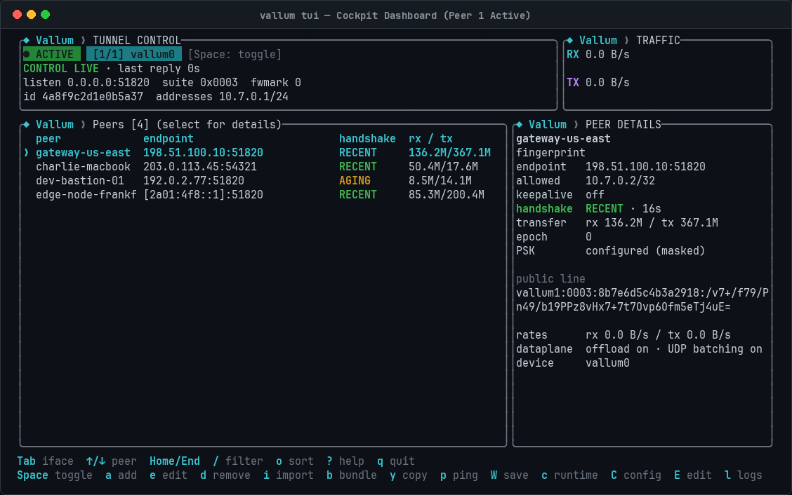
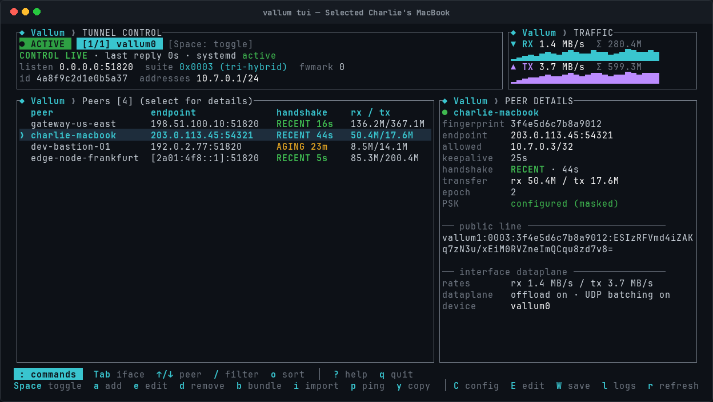
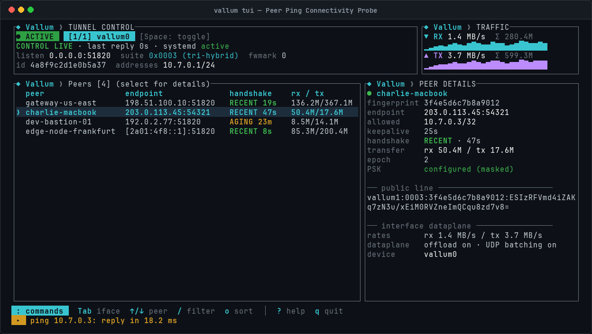
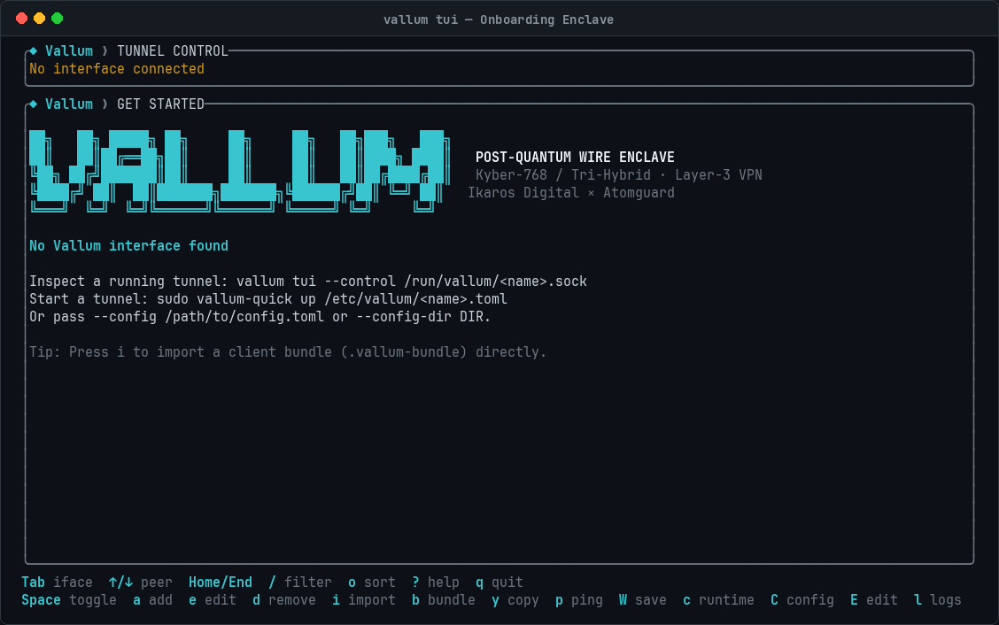

# Vallum

[](LICENSE)
[](Cargo.toml)

A hybrid **post-quantum layer-3 tunnel** — a real userspace VPN, not a reference
crate. Developed in joint engineering partnership between **Ikaros Digital** and **Atomguard**.

<p align="center">
  
</p>
<p align="center">
  <em>Live operations cockpit: tri-hybrid PQ tunnel state, active peers, connectivity ping probes, smart filters, and journald telemetry.</em>
  <br>
  <a href="assets/vallum-demo.mp4"><b>▶ Download HD Video Capture (.mp4)</b></a> · <a href="assets/vallum-cockpit.svg"><b>View Vector SVG</b></a>
</p>

Vallum is built *on top of* `origin-crypto-sdk` but never *inside* it: every
cryptographic operation Vallum performs goes through a Vallum-owned boundary
trait, so the SDK can be swapped — or replaced with from-scratch cryptography —
without touching the protocol.

## Why it exists

PQ-WireGuard (Hülsing–Ning–Weber–Schwabe–Zimmermann, 2023) proved a KEM-only
handshake can replace WireGuard's non-interactive DH. Vallum takes that design as
the floor and pushes on the five things it leaves on the table:

| Vector | Gap in PQ-WireGuard | Vallum |
|---|---|---|
| Hybrid KEM | one classical + one PQ leg, single KEM each | tri-hybrid `X25519 + sntrup761 + ML-KEM-768`, combined with HKDF-SHA3-256 |
| Hybrid signature auth | none (static KEM keys only) | Ed25519 + Falcon-1024 over the transcript, with CA-issued identity documents and a signed validity window |
| Key reuse | none | **rejected on purpose** (P3): one master seed → a KEM key *and* an independently derived signing key; no dual-use key |
| Epoch axis | no epoch, no erasure discipline | rekey is a fresh hybrid handshake (root independence), 2⁴⁸/2⁴⁹ caps, one superseded epoch erased after `REJECT_AFTER_TIME` |
| Traffic analysis | none | Maybenot-style shaping, off by default, padding inside the AEAD |
| Identity lifetime | static key, no expiry, no CA | identity documents with a signed validity window (ADR-0014) |
| Key rotation | manual, with an outage | `peer rotate` keeps the old key accepted until `finalize` (ADR-0014) |
| Operations | no metrics endpoint, `resolvconf` only | `vallum metrics`, `resolvectl` with a `~.` domain, `doctor --probe-mtu`, `pin_endpoint` (ADR-0014) |

It also keeps the good parts of WireGuard (cryptokey routing, TAI64N, keyed MAC
cookies, roaming by authenticated source) and strengthens suite negotiation:
WireGuard offers no negotiation, Vallum *binds the suite id into the transcript*,
so a downgrade is **detectable**.

## The boundary (the load-bearing idea)

```
   protocol (handshake · key schedule · framing · data plane)
        │  bytes only — no provider type crosses this line
        ▼
   vallum-crypto        -- CryptoSuite trait + protocol combiners (no deps)
        ▲
   ┌────┴─────────────────────────┐
   │                              │
vallum-crypto-sdk            (future: from-scratch adapter)
(origin-crypto-sdk)          same trait, new suite id
```

- **`vallum-crypto`** — the `CryptoSuite` trait and the protocol-level combiner
  and transcript hash. Zero dependencies, zero cryptographic implementations.
- **`vallum-crypto-sdk`** — the only crate that names an SDK type.
- **`vallum-crypto-contract`** — a suite-agnostic test harness. It depends on
  `vallum-crypto` only, so it applies unchanged to any adapter.

Swapping crypto = one new adapter + one new suite id + refreshing the KATs. The
handshake, key schedule, framing, and data plane do not change.

## Handshake

Three messages, three hybrid-KEM operations, one round trip:

```
Initiator                                              Responder
InitHello    ── STATIC_CT (A) · EPHEMERAL_PK · TIMESTAMP ──▶   [static key]
             ◀── EPHEMERAL_CT (B) · STATIC_CT (C) · conf_r ──   RespHello
InitConf     ── conf_i ────────────────────────────────────▶   [verify]
```

| op | direction | peer key | purpose |
|----|-----------|----------|---------|
| A | init → resp | responder **static** | responder authentication |
| B | resp → init | initiator **ephemeral** | forward secrecy |
| C | resp → init | initiator **static** | initiator authentication |

Both static operations are **MEX-bound** (`KDF1(σ, r)`): the sender's own
long-term secret is mixed into the encapsulation randomness, so a subverted RNG
cannot fix the shared secret. Confirmation is **mutual and explicit** — the
responder proves key possession in `RespHello`, the initiator in `InitConf` — so
neither party accepts a key before authenticating the other. That is the property
whose absence kept WireGuard out of eCK-PFS-PSK; see `docs/proof/eck-pfs-psk.md`.

## Suite registry

| id | legs | status |
|----|------|--------|
| `0x0001` | X25519 + sntrup761 | supported (non-NIST-pure fallback) |
| `0x0002` | X25519 + ML-KEM-768 | supported |
| **`0x0003`** | **X25519 + sntrup761 + ML-KEM-768** | **default** |
| `0x0100+` | reserved for from-scratch cryptography | — |

The two post-quantum legs are **independently implemented** (SDK NTRU Prime vs
pinned RustCrypto ML-KEM), so an implementation fault in either is covered by
the other. This does **not** protect against a break of the lattice family
itself — a code-based leg would be needed for that, and the SDK does not ship
one (recorded as an open limitation).

## Deploy

A Vallum server is one command, and a client is another. Both are the same
daemon; only the config differs.

```sh
# server: install a release, then key + config + forwarding + firewall + NAT + service
sudo ./scripts/install.sh --from-release --endpoint vpn.example.com --address 10.7.0.1/24

# enrol a device; it receives one bundle file and imports it
sudo vallum peer add laptop --bundle-out laptop.vallum-bundle --forget-key
sudo vallum import-bundle laptop.vallum-bundle --install   # on the device
```

`vallum server init` is idempotent and `--dry-run` prints the whole plan before
anything is touched. `vallum peer add --public-key` is the other custody model:
the device generates its own key and only its public line travels.

Guides: [server](docs/deployment/server.md) ·
[client](docs/deployment/client.md) ·
[site-to-site](docs/deployment/site-to-site.md) ·
[automation](docs/deployment/automation.md) ·
[troubleshooting](docs/deployment/troubleshooting.md).

## Layout

```
Cargo.toml                        workspace
crates/
  vallum-crypto/                  boundary: trait + combiners (no deps)
  vallum-crypto-sdk/              origin-crypto-sdk adapter (and the CT harnesses)
  vallum-crypto-contract/         suite-agnostic contract tests
  vallum-core/                    handshake · key schedule · TLV wire · data plane
                                  · epoch · shaping · segmentation · identity
  vallum-tunnel/                  sans-IO transport: peers, routing, handshakes
  vallum-protocol-tests/          suite-dependent tests and benchmarks
  vallum-quick/                   routes, DNS, firewall and hooks (admin tool)
  vallum/                         the daemon: TOML, TUN, UDP, privileges, CLI
packaging/                        systemd units, man pages, completion
docs/deployment/                  server, client, site-to-site, automation, troubleshooting
scripts/install.sh                install a release, then `vallum server init`
scripts/release.sh                build and publish a release locally
fuzz/                             cargo-fuzz workspace (four targets)
docs/proof/                       one artefact per gate
  eck-pfs-psk · committing-aead-multikey · hybrid-identity · ratchet-pcs
  traffic-shaping · transport · segment · keepalive · pentest · daemon
  constant-time · benchmarks · fuzzing · privileges · mtu · ipv6 · dual-stack
  identity-validity · tamarin
scripts/
  e2e-netns.sh                    two namespaces, real kernel, four lifecycles
  ct.sh · fuzz.sh                 the measurement and fuzzing gates
```

Hosted GitHub Actions is disabled on the private/free plan; the gate of record
is local: `./scripts/verify.sh` (add `E2E=1` for the namespace tunnel test).

## Build

The workspace pins the SDK by path, so clone both repositories as siblings:

```sh
git clone https://github.com/KidIkaros/vallum.git
git clone https://github.com/KidIkaros/OriginSDK.git origin-crypto-sdk
cd vallum
cargo test --workspace
```

`scripts/bootstrap.sh` does the sibling clone for you. The `fast` profile is
suite `0x0002` (X25519+ML-KEM-768): generate a key with `vallum keygen --suite 2`.
It completes a handshake in ~1.81 ms versus ~54 ms for the default tri-hybrid;
the default stays tri-hybrid for KEM diversity.

## TUI (Terminal Operations Cockpit)

`vallum tui` is a terminal operations cockpit for real-time monitoring and tunnel administration: live device state, peer add/edit/remove, peer connectivity ping probes, smart filtering, QR client-bundle export, runtime parameter changes, service toggle, and journald log streaming. It communicates over the local `0600` control socket without requiring root privileges for day-to-day operations.

<p align="center">
  
</p>

### Dogfooding & Operations Showcase

| Live Cockpit & Peer Telemetry | Command Palette (`:` — No Memorized Keys) |
|:---:|:---:|
|  |  |
| **Peer Ping Connectivity Probe (`p`)** | **Optical Client Bundle QR (`b` — ISO 18004)** |
|  |  |
| **Semantic Journald Logs (`l`)** | **VALLUM Onboarding Enclave** |
|  |  |

### Brand & Visual Identity System

<p align="center">
  
</p>

Generate that frame yourself with
`vallum tui --control /run/vallum/<name>.sock --snapshot --ansi --width 120 --height 32`.
The QR export asks for the server endpoint (an unspecified `0.0.0.0`/`[::]` is rejected);
`vallum import-bundle <file> --output-dir DIR` unpacks a bundle into a config
and a 0600 key. See [`docs/tui.md`](docs/tui.md) for the key map and limits.

## Operator Ergonomics & UX Principles

Vallum's terminal interface is built in accordance with cognitive psychology and human-computer interaction (HCI) principles (*The Design of Everyday Things*, *Designing with the Mind in Mind*, and *Designing the User Interface*):

```
┌────────────────────────────────────────────────────────────────────────┐
│                      OPERATOR COGNITIVE SURFACE                        │
├───────────────────────────────────┬────────────────────────────────────┤
│ Recognition Over Recall           │ Forgiving Interaction              │
│ • Bottom action capsules          │ • Side-by-side config diff audit   │
│ • Progressive disclosure panes    │ • Peer deletion identity preview   │
│ • Scaled throughput (B/s → GB/s)  │ • Fixed-length secret masking      │
├───────────────────────────────────┼────────────────────────────────────┤
│ Dual Delivery & Ergonomics        │ Perceptual Feedback                │
│ • Vim navigation (j/k, g/G, /)    │ • Modeless status toasts (ping RTT)│
│ • OSC 52 + desktop clipboard      │ • Semantic log highlighting        │
│ • Bracketed paste protection      │ • Handshake freshness heuristics   │
└───────────────────────────────────┴────────────────────────────────────┘
```

- **Progressive Disclosure & Cognitive Chunking**:
  The dashboard table presents a scannable summary of interface health and peer states. Selecting a peer expands full cryptokey routing, cryptographic identity, and transport telemetry in the side details panel without visual clutter.
- **Auto-Scaled Data Rates**:
  Throughput rates dynamically scale (`B/s`, `KB/s`, `MB/s`, `GB/s`) so operators perceive bandwidth changes instantly without mentally counting digits.
- **Recognition Over Recall**:
  Persistent key capsules at the bottom adapt to terminal geometry, ensuring operators never need to memorize hotkeys.
- **Safe, Forgiving Operations**:
  TOML config changes edited in `$EDITOR` (`E`) display a side-by-side colorized diff view before applying. Peer removal (`d`) requires confirmation showing peer identity and allowed prefixes to prevent accidental disconnection.
- **Dual-Tier Clipboard Delivery**:
  Yanking public lines (`y`) or peer IPs (`Y`) simultaneously emits ANSI OSC 52 escape sequences (working seamlessly over remote SSH and tmux sessions) and integrates with desktop clipboards (`wl-copy`, `xclip`).
- **Immediate Modeless Feedback**:
  Asynchronous actions (such as the `p` peer connectivity probe or log refreshes) display non-intrusive toasts with round-trip times without interrupting operator workflows.

## Test

```sh
cargo test --workspace      # unit + integration + boundary contract tests
cargo clippy --workspace --all-targets -- -D warnings
cargo fmt -p vallum-core -p vallum-tunnel -p vallum -p vallum-crypto \
          -p vallum-crypto-sdk -p vallum-crypto-contract -- --check
cargo deny check            # licenses, sources, bans, advisories
bash scripts/e2e-netns.sh   # two namespaces, a real kernel, four lifecycles
bash scripts/ct.sh          # DudeCT constant-time gate
bash scripts/fuzz.sh 60     # four cargo-fuzz targets
cargo bench -p vallum-protocol-tests  # handshake and data-plane baselines
```

Byte-exact handshake vectors are frozen in `crates/vallum-protocol-tests/tests/interop.rs`
and regenerate with:

```sh
cargo test -p vallum-protocol-tests --test interop -- --ignored --nocapture
```

The contract tests (`crates/vallum-crypto-contract`) exercise KEM keygen/round-
trip/tamper-rejection, the combiner, the transcript hash, committing-AEAD seal/
open + forgery rejection, and hybrid signature verify/reject — for every shipped
suite, plus an adapter-swap smoke test.

## Status

Every phase is implemented and gated: **P0–P6.8** (boundary through the daemon,
keepalive, segmentation, and the admission tag), all seven proof obligations
(including the Tamarin model and the PSK-tag DoS/replay model), **H1–H9**
(constant-time, benchmarks, fuzzing and CI, privilege separation, MTU-aware
segmentation, IPv6, identity validity, dual-stack addressing), the **G1–G6**
operational surface (configured PSK, UAPI, runtime rebind, `vallum-quick`,
batching, platform tier), and the **TUI**. The architecture decisions are in
[`docs/adr/`](docs/adr/), including
[ADR-0014](docs/adr/0014-wireguard-gaps.md), which records the WireGuard gaps
Vallum closes and the ones it deliberately does not. `docs/proof/` holds one artefact per gate, and each one
states what it does **not** claim.

Known open items are product decisions rather than missing work: a code-based
(non-lattice) KEM suite for true family diversity, the Rosenpass-style PSK bridge,
and the final name. The SDK's custom sntrup761 is the cost centre — ~9 ms per
decapsulation here, versus ~0.25 ms for the ML-KEM leg — which is why the
alternative-suite work matters.

A dual-stack tunnel is one config: `addresses = ["10.7.0.1/24", "fd00:7::1/64"]`.
 
## Partnership
 
Vallum is co-developed through a joint engineering partnership between **Ikaros Digital** and **Atomguard**, uniting post-quantum cryptographic research, zero-compromise security engineering, and operator-focused systems design.
