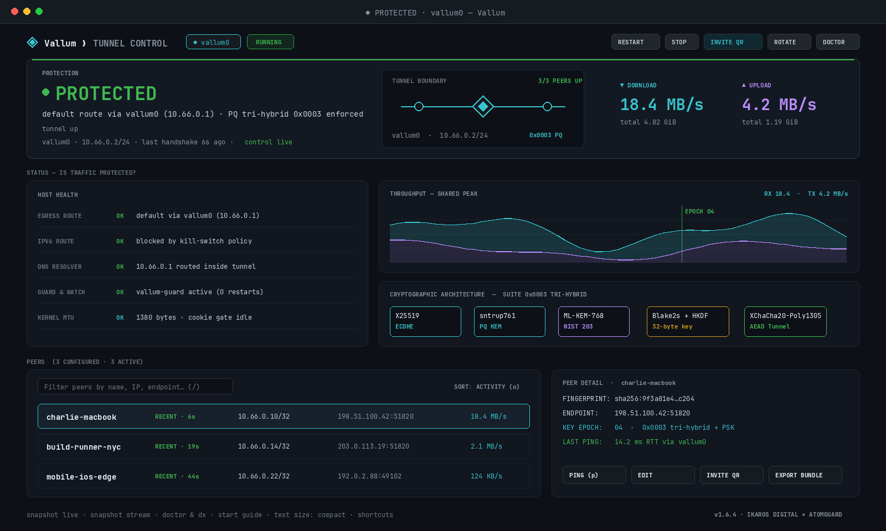

# `vallum-gui` — The Desktop & Localhost Operations Console

`vallum-gui` is Vallum's graphical operations cockpit. It communicates over the same `get=1` UAPI control socket protocol as `vallum tui` ([`docs/tui.md`](tui.md)), respects the `0600` socket / `0770` runtime-directory security boundaries, and provides two deployment transports for the same React 19 + Tailwind CSS v4 cockpit:

```sh
# 1. Native desktop application (Tauri)
vallum-gui

# 2. Authenticated localhost HTTP console (loopback-only, token -> HttpOnly SameSite=Strict cookie)
vallum-gui --serve 7317
vallum-gui --serve 7317 --ui crates/vallum-gui/ui/dist
```

<p align="center">
  
</p>

## Sections & Live Visual Telemetry

The console organizes operational workflows into 4 intuitive sections with global command palette (`:`) and keyboard shortcut support:

### 1. Overview (`1`)
- **Protection Banner & Boundary Geometry:** Dynamic egress state verdict (`PROTECTED`, `SPLIT`, `DNS LEAK`, `V6 LEAK`, `UNPROTECTED`, or `NO DAEMON`), paired with the live Rampart Boundary Geometry schematic featuring animated SVG packet vectors and responder beacon pulses.
- **Data Flow & Topology (`TunnelFlowMap`):** Real-time 3-stage network flow map:
  - *Stage 01: Local Node:* Egress posture (Full vs. Split), `vallum-guard` state, IP/port indicators.
  - *Stage 02: Egress Lanes:* Animated IPv4, IPv6, and DNS lanes with throughput-reactive stream animations (`flow-stream-slow` / `flow-stream-fast`) and live bidirectional pipe bandwidth meters.
  - *Stage 03: Peer Mesh:* Real-time activity cards for enrolled peers with directional RX/TX share bars and active ping halos.
- **Host Health & Cryptographic Architecture:** Systemd daemon status, route resolution, and interactive breakdown of cryptographic suite stages (e.g. `X25519 + sntrup761 + ML-KEM-768 -> Blake2s/HKDF -> XChaCha20-Poly1305`).
- **Throughput & Top Talkers:** Shared-scale Catmull-Rom cubic spline charts with live leading-edge beacons and handshake timeline markers.

### 2. Connected Devices (`2`)
- **Device Management:** Filter, inspect, and manage active peers.
- **Zero-Custody Invites (`+ Invite Device`):** Mint time-limited (`15m`, `1h`, `24h`, `7d`) single-use join tickets and animated `VALLUM1` QR codes scannable directly from mobile devices.
- **Smart Peer Presets:** Next-available IP subnet suggestions (`10.7.0.x/32`) and keepalive chips (`25s NAT`, `60s`, `Off`).
- **Interactive Peer Actions:** One-click ICMP ping probe (`p`), live identity key rotation (`rotate` ➔ `finalize`), bundle export (`.vallum-bundle`), and removal confirmation.

### 3. Monitoring & Diagnostics (`3`)
- **Packet Pipeline Flow:** Real-time 4-stage packet processing counters (`1. Wire ingress` ➔ `2. Handshake gate` ➔ `3. Tunnel delivery` ➔ `4. Wire egress`) with live counter pulse alerts.
- **Directional Balance & Peer Share:** Real-time percentage volume breakdown by direction and peer.
- **Logs Panel:** Live journald log streaming with filterable severity levels (`error`, `warn`, `info`, `debug`).

### 4. Settings & Routing (`4`)
- **User Identity & Keys (`UserKeyCard`):** Host identity badge, operator alias, assigned tunnel IP, and active public key line (`vallum1:...`) with copy, `.pub` download, and scannable public identity QR code.
- **Offline Keypair Generator Studio:** Mint loose ML-KEM-1024 + X25519 + ML-DSA-65 identity keypairs with immediate inspection, copy, and `.key` export.
- **User Settings & Defaults (`UserPreferencesPanel`):** Persistent operator alias, node role (`Client`, `Gateway`, `Mesh`), default invite expiration, keepalive defaults, auto-copy invite toggle, and 1-click TOML config backup.
- **Network & Daemon Configuration:** Structured interface settings (with DNS presets like Cloudflare `1.1.1.1`, Quad9 `9.9.9.9`, Mullvad, and MTU chips), listen port rebinding, and raw TOML editor with line-by-line diff audit.

---

## Keyboard Shortcuts

Keyboard shortcuts are automatically suppressed whenever an input field or dialog is focused.

| Key | Action |
|---|---|
| `1` – `4` | Switch cockpit section (`Overview`, `Devices`, `Monitoring`, `Settings`) |
| `Cmd/Ctrl+K` or `:` | Open command palette (`PeerPalette`) |
| `/` | Focus peer filter input |
| `j` / `k` or `↓` / `↑` | Select next / previous peer |
| `o` | Cycle peer sort order (`Activity`, `Transfer`, `Name`, `Key`) |
| `Tab` or `[` / `]` | Cycle active tunnel interfaces |
| `r` | Refresh host health, service state, and preflight facts |
| `i` | Open interface settings modal |
| `E` | Open raw TOML configuration editor with diff |
| `W` | Save runtime peers to disk config |
| `d` | Open Doctor, `VAL-E*` error catalog, and diagnostic export |
| `?` | Toggle keyboard shortcuts modal |
| `Esc` | Dismiss modal or clear peer filter |

---

## `VAL-E*` Diagnostic Error Codes & Exit Contract

`vallum-gui` maps raw socket errors, permission failures, Linux capabilities, routing leaks, and cryptographic alerts into actionable diagnosis cards inside the **Doctor & DX** modal (`d`):

| Code | Domain | Exit | Description & Remediation |
|---|---|---|---|
| `VAL-E101` | Control | `2` | Control socket permissions too open (`!= 0600`) or directory world-writable |
| `VAL-E102` | Control | `2` | `/run/vallum` unreadable by current user (missing group permission) |
| `VAL-E103` | Control | `2` | Control socket silent (`ENOENT` / `ECONNREFUSED` — daemon stopped) |
| `VAL-E201` | Config & Keys | `2` | Private key file permissions too open (`mode != 0600`) |
| `VAL-E202` | Config & Keys | `2` | Config file ownership denied (`chown root:root` needed) |
| `VAL-E203` | Config & Keys | `2` | TOML parsing or CIDR `allowed_ips` validation failure |
| `VAL-E301` | Daemon & OS | `1` | Seccomp syscall filter violation (`status=31/SYS`) |
| `VAL-E302` | Daemon & OS | `1` | TUN device creation refused (`CAP_NET_ADMIN` / `/dev/net/tun`) |
| `VAL-E303` | Daemon & OS | `1` | Polkit / systemd unit control authorization rejected |
| `VAL-E401` | Egress & Leaks | `1` | Full-tunnel DNS leak detected outside tunnel |
| `VAL-E402` | Egress & Leaks | `1` | IPv6 egress leak detected while `vallum-guard` is inactive |
| `VAL-E403` | Egress & Leaks | `1` | Full-tunnel route configured (`0.0.0.0/0`), but host reports `UNPROTECTED` |
| `VAL-E501` | Crypto | `2` | Cryptographic suite mismatch or malformed `vallum1:` public key line |

