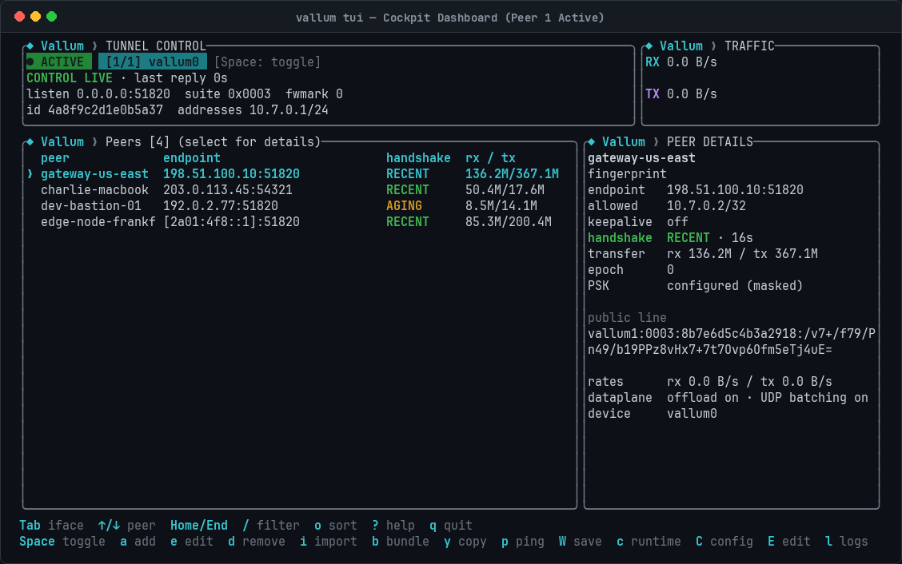

# `vallum tui` — the operations console

`vallum tui` is a terminal dashboard for a running Vallum daemon. It talks to the
0600 control socket, so it needs the same user as the daemon; it does not need
root for status or peer changes.

```sh
vallum tui --config /etc/vallum/vallum0.toml
vallum tui --control /run/vallum/vallum0.sock
vallum tui --config-dir /etc/vallum
vallum tui --snapshot --ansi --width 120 --height 36   # headless, with ANSI styles
```

<p align="center">
  
</p>

## Keys

| Key | Action |
|---|---|
| `Space` / `s` | toggle tunnel service (systemd first, then `vallum-quick`) |
| `Tab` / `Shift-Tab` | next/previous interface (or click tab with mouse) |
| `j` / `k`, arrows | select peer (or click row / scroll wheel with mouse) |
| `/` | filter peers by name, IP, endpoint, or fingerprint |
| `o` | cycle peer sorting order (`natural`, `handshake`, `transfer`, `name`) |
| `Home` / `End`, `g` / `G` | jump to first / last peer; top / bottom in logs, diff, and help |
| `PageUp` / `PageDown` | scroll peer table (5 rows) / scroll logs, diff, and help |
| `p` | ping selected peer's tunnel IP |
| `a` | add peer (name, public line, endpoint, allowed IPs, keepalive, PSK) |
| `e` | edit name, endpoint, allowed IPs, keepalive, PSK |
| `d` | remove peer (confirmation with peer details preview) |
| `i` | import client bundle (`.vallum-bundle`) into the daemon directly |
| `g` | generate a key and prefill the add form |
| `b` (or `x`) | export the client bundle and show its animated QR |
| `y` | copy peer (or interface) public line to clipboard (OSC 52 + desktop clipboard) |
| `Y` | copy peer address / endpoint (or interface address) to clipboard |
| `W` | write/save runtime peers and configuration to disk file |
| `c` | edit the runtime listen port and fwmark (temporary) |
| `C` | edit listen/MTU/fwmark/addresses/DNS/table (on disk) |
| `E` | edit the TOML in `$EDITOR`; review the two-column diff, Enter applies, Esc keeps the file |
| `l` | load journald logs (scroll with `j`/`k`, `PageUp`/`PageDown`, `Home`/`End`) |
| `f` | toggle log follow (in the Logs view) |
| `r` | refresh the device snapshot now |
| `R` | toggle the 1-second auto-refresh on/off |
| `?` / `F1` | help (scrollable) |
| `q` / `Q` / Ctrl-C | quit (or close modal/help/logs/diff) |

## What it does

- **Dashboard**: interface identity and settings, a control-health band, and
  peer name, fingerprint, endpoint, allowed IPs, handshake freshness, rx/tx
  totals, epoch, and PSK presence. `CONTROL LIVE/STALE/UNAVAILABLE` describes
  UAPI reachability; a systemd unit state is polled separately every 5 seconds
  for config-backed interfaces when detectable. The status badge reports that
  unit state (`ACTIVE`, `INACTIVE`, `STARTING`, `STOPPING`, `FAILED`) or
  `NO UNIT` when no unit is known — it never guesses from control health.
  Handshake labels are a heuristic: `RECENT` is under 5 minutes, `AGING` is
  under 1 hour, `OLD` is at least 1 hour, and `NEVER` means no handshake is
  recorded. They do not prove that the peer is online. Dataplane offload and
  UDP batching appear in Details. The table hides secondary columns on narrower
  terminals, and the dashboard stacks peers and details below 100 columns.
  If the control socket drops, the UI marks retained data as stale and `r`
  retries instead of presenting it as live.
- **Branding**: a modern cockpit aesthetic with rounded borders, a distinct
  `◆ Vallum ❯ <section>` wordmark breadcrumb across panels, joint partnership attribution
  (`Ikaros Digital × Atomguard`), and a compact wordmark with a small
  boundary/crossing mark in the onboarding empty state — no large ASCII banner.
  Live tunnel state and security telemetry remain the clear visual focus.
- **Forms**: the focused field and insertion point are visible; arrows and
  Home/End move within text, Backspace/Delete edit in place, and Ctrl-U clears
  the current field. Secret fields use a fixed mask so their length is not
  displayed. Validation errors persist in the form, identify the invalid field
  when possible, and retain entered values until a corrected submission or
  cancellation.
- **Empty state**: when no interface is discoverable, the TUI shows direct
  commands and flags for connecting to or starting a tunnel instead of empty
  peers/details panes.
- **Peer CRUD** through the UAPI. The public line is decoded and checked against
  the device suite; endpoint hostnames are resolved; allowed IPs are validated.
- **Key generation** writes a 0600 key file and prefills the add form with the
  public line. If the config directory is not writable (for example
  `/etc/vallum` for a non-root operator), it falls back to
  `$XDG_CONFIG_HOME/vallum` or `~/.config/vallum`.
- **Bundle export** asks for the server endpoint (defaulting to the daemon's
  listen address; an unspecified `0.0.0.0`/`[::]` is rejected), writes a
  versioned JSON bundle (config + key file) as a `.vallum-bundle` file, and
  shows an animated multi-frame QR. The QR contains the private key; the modal
  says so and is cleared on close.
- **Bundle import** is `vallum import-bundle <file> --output-dir DIR`; it writes
  the config and a 0600 key, refusing to overwrite without `--force`.
- **Config edits**: `E` backs up before `$EDITOR` and shows a two-column diff;
  `C` edits structured fields, asks for confirmation, then writes through a
  validated sibling file with a timestamped backup. In both flows Enter
  applies and restarts the service; Esc keeps the file unapplied.
- **Service control**: `systemctl start/stop vallum@<stem>.service` when the
  unit exists; otherwise `vallum-quick up/down` if already root, or the exact
  `sudo` command when not. No sudo prompt is opened by the TUI.
- **Logs**: `journalctl -u vallum@<stem> -n 200 --no-pager -o cat`; `r`
  refreshes, `f` polls every second, and an empty/unavailable journal is shown
  as a message rather than a blank pane.

## Security

- Secrets are masked. The private key and PSK are never rendered; the QR is the
  only secret-bearing view and requires an explicit keypress.
- No shell: `systemctl`, `journalctl`, `vallum-quick`, and `$EDITOR` are spawned
  with argument arrays, never `sh -c`.
- The control socket is the same trust boundary as the private key (0600,
  same user). Each config must use a unique `control` path; relative paths are
  resolved against the config directory, so two configs with
  `control = "control.sock"` in one directory collide.
- Config edits through `$EDITOR` are not auto-applied; restart or `syncconf`
  after reviewing the diff.

## Limits

- Terminal-only; no GUI, camera QR scanning, or Windows named-pipe control.
- Interface/routes/DNS changes are raw TOML through `E`, not structured forms
  yet; peer and runtime-device changes are forms.
- `p` pings the peer's first allowed IP synchronously (~1 s worst case).
- The QR is an export format; import is from the `.vallum-bundle` file.
