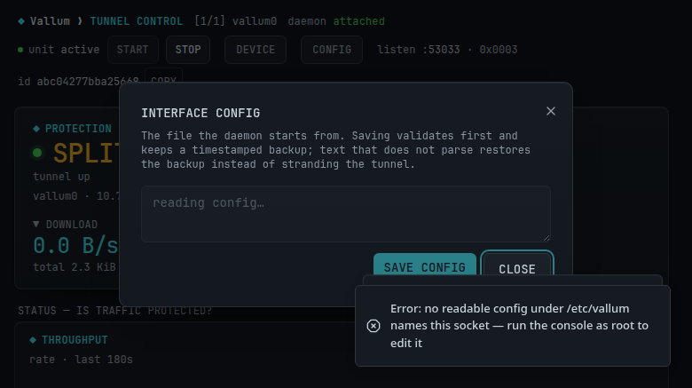
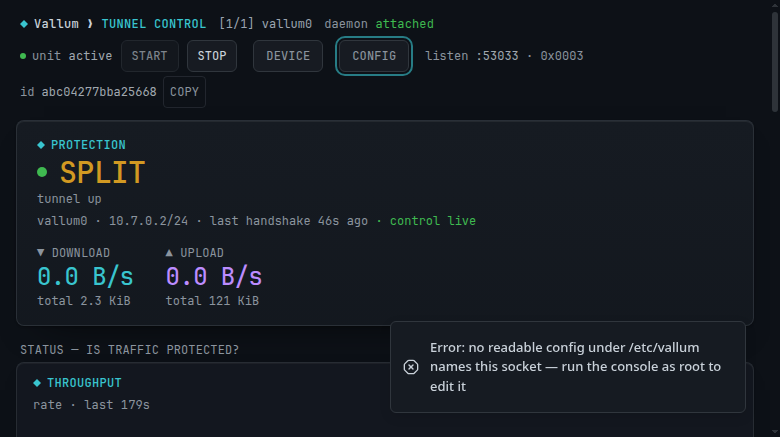

# Vallum console — dogfood report

**Target:** `http://127.0.0.1:7317` (`vallum-gui --serve`, the HTTP+SSE surface)
**Build:** `vallum-gui` release, rebuilt at test time (44.9 s), UI `dist` from 07:57
**Client state:** one interface `vallum0`, split tunnel, peer `vps` reachable at 64 ms
**Date:** 2026-11-12

## Executive summary

**4 findings: 0 critical, 0 high, 3 medium, 1 low.** No console errors at any
point — `window.__qa_errors` stayed empty across every navigation and interaction.

The console is in good shape. It renders a truthful, mode-aware verdict, its live
actions report progress, every button carries an accessible name, and nothing
overflows. The findings are about **expected conditions presented as errors** and
**states that render blank instead of explaining themselves**.

| # | Severity | Category | Title |
|---|---|---|---|
| 1 | Medium | UX | `DEVICE` and `CONFIG` open with a raw root-permission error toast, twice |
| 2 | Medium | UX | Peer filter with no matches leaves a blank area, no empty state |
| 3 | Medium | Functional | Invite form accepts a name that can never work, then submits silently |
| 4 | Low | UX | First paint reports a control error on a healthy tunnel |

### A correction, recorded rather than quietly fixed

My first draft of this report claimed *"`DEVICE` and `CONFIG` both open the
command palette"*. **That was false.** Both open correct dialogs (`RUNTIME
DEVICE`, `INTERFACE CONFIG`); my DOM query had taken the first `[role=dialog]`
match while the command palette was still open behind them. The screenshot caught
it. Selecting dialogs by title rather than by position is the fix, and it is worth
noting because the wrong version of this finding was more alarming than the real
one.

---

## 1. `DEVICE` and `CONFIG` open with a raw root-permission error toast, twice

**Severity:** Medium · **Category:** UX

Both dialogs open correctly, and both immediately show:

```
Error: no readable config under /etc/vallum names this socket — run the console
as root to edit it
```

…and the identical toast appears **twice**.

This is the *expected* state for a console run as the operator rather than root:
the config is `0600 root`, so reading it is impossible by design. But it is
presented as an `Error:` on **open**, when the form is in fact usable — the
`RUNTIME DEVICE` fields are populated from the daemon (placeholders `53033`, `0`
match the live values), and only *saving* would need root.

**Steps:** load `/` as a non-root user → click `DEVICE` → observe the toast. Click
`CONFIG` → same, twice.
**Expected:** a quiet, persistent note on the editable control ("saving needs
root"), or the error only when a save is attempted.
**Actual:** an error-styled toast, duplicated, on open.

**Secondary:** the duplication suggests two listeners each firing on the same
failure — worth a look regardless of the wording.



## 2. Peer filter with no matches leaves a blank area

**Severity:** Medium · **Category:** UX

Typing a non-matching string into `Filter peers` empties the peer list and
renders **nothing** — no "no peers match", no offer to clear the filter.

**Steps:** focus `Filter peers` → type `zzzznomatch`.
**Expected:** an empty-state line naming the filter, with a way to clear it.
**Actual:** blank table body. With a single peer this is easy to mistake for a
loading state.



## 3. Invite form accepts a name that can never work, then submits silently

**Severity:** Medium · **Category:** Functional · **Partially verified**

The invite form's name field accepts **80 characters** with no validation and no
counter. A peer name becomes the interface name `vallum-<name>`, and the kernel
limit is 15 bytes — so an 80-character name produces a peer that cannot connect.
`vallum-operations` records the same constraint from the other end (names must
differ in their first eight characters).

Clicking `INVITE` with that name produced **no observable result**: no console
error, no toast, no dialog text change, and no new invite file — the invites in
`/run/vallum` all predate the attempt by sixteen hours.

**Caveat, stated rather than hidden:** the submit path is shared with the command
palette and two of my clicks landed on a palette entry rather than the form's
submit. The **validation gap is solid** (80 characters accepted, read from the
field); the **silent submit** is observed twice but not proven to be the submit
button.

**Expected:** the field caps at a workable length and says why, or the submit
returns an error naming the limit.
**Actual:** any length is accepted; the submit gives no feedback either way.

## 4. First paint reports a control error on a healthy tunnel

**Severity:** Low · **Category:** UX

Before the first snapshot arrives the console renders:

```
daemon silent
unit active
last control error: no interface selected
```

while `/api/interfaces` already returns `vallum0` and the daemon is running. It
resolves on its own within ~6 s.

**Expected:** a loading state ("connecting to vallum0…").
**Actual:** the most alarming string in the UI, on a working system.


---

## What holds up, and is worth not breaking

- **The verdict is truthful and mode-aware:** `● SPLIT` with
  `tunnel up · vallum0 · 10.7.0.2/24 · last handshake 9s ago · control live`, and
  every EGRESS HEALTH row reads `split by design` — including
  `guard OK not needed in split mode` and `routes OK not needed in split mode`.
  No row cries wolf on a working system.
- **PING is honest about progress:** the button becomes a disabled `…`, then
  reports `3/3 replies from 10.7.0.1 · 64.7 ms avg`.
- **Escape closes the palette** — verified twice. My first reading ("Escape does
  not close it") was an animation artefact and would have been a false finding.
- **Every button has an accessible name** — zero buttons without text or
  `aria-label`.
- **No horizontal overflow** at 780 px.
- **Peer detail is rich and correct:** fingerprint, endpoint, allowed IPs
  (`10.7.0.1/32`), keepalive `25s`, transfer, handshake age, key version `145`.
- **Zero console errors** across the session.

## Not tested

- `START` / `STOP` — the unit is live; stopping it takes the tunnel down.
- `+ ADD PEER`, `REMOVE`, `ROTATE`, `BUNDLE`, `IMPORT` — writes against a live
  deployment. The invite path was exercised instead, reported above.
- The full-tunnel apply flow (`type APPLY to arm`) — deliberate: it re-routes the
  host, and gate 3 already proves that path inside a container.
- Responsive behaviour above 780 px, and the Tauri (non-`--serve`) transport.
